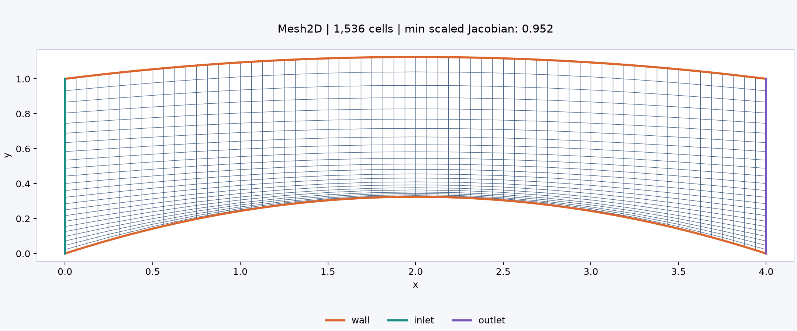
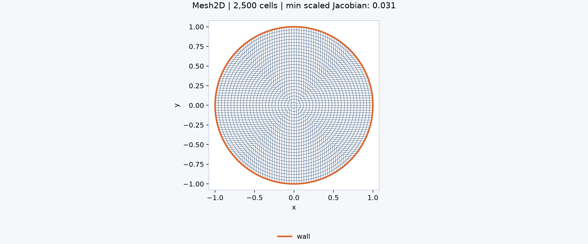
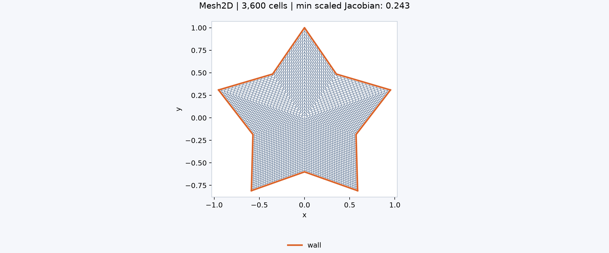

# Mesh2D

Генератор структурированных двумерных сеток по заданной геометрии.

Проект исследует построение четырёхугольных сеток для плоских конечно-объёмных задач с экспериментальным методом на основе машинного обучения. На вход подаются геометрия в JSON и число ячеек; на выходе — сетка, показатели качества и изображение по запросу. Решатель течения или теплообмена в проект не входит.

## Документация

- [Описание проекта](docs/project/overview.md)
- [Требования и User Stories](docs/project/requirements.md)
- [Сценарии использования](docs/project/use-cases.md)
- [Диаграммы Mermaid](docs/project/diagrams.md)

## Запуск

Нужны Python 3.11–3.14 и Poetry 2. Из корня проекта:

```sh
poetry install
poetry run mesh2d examples/channel.json --format vtk -o out/channel.vtk
poetry run mesh2d examples/channel.json --format su2 -o out/channel.su2
poetry run mesh2d examples/channel.json --method tfi --format vtk -o out/classical.vtk
poetry run mesh2d examples/channel.json --format foam -o out/case/system/blockMeshDict
poetry run python -m unittest discover -s tests
```

Откройте VTK в ParaView и выберите **Surface With Edges**. SU2 содержит именованные граничные рёбра. Для OpenFOAM перенесите blockMeshDict в system/ существующего расчётного случая и выполните blockMesh и checkMesh. Каждая плоская ячейка представлена одним блоком единичной толщины с одним слоем по z; торцы имеют тип empty. Боковые границы по умолчанию имеют тип patch: конкретные типы стенок и условия для полей задайте в расчётном случае. Экспорт словаря рассчитан на небольшие сетки.

## Примеры сеток

Канал с криволинейными стенками — 1536 ячеек, метод `ai`.



Круг — 2500 ячеек, геометрический метод `radial`.



Пятиконечная звезда — 3600 ячеек, геометрический метод `radial`.



Круг и пятиконечная звезда: `poetry run mesh2d examples/circle.json --method radial --format vtk -o out/circle.vtk --plot out/circle.png --show`. Для звезды замените circle на star. Это геометрическое радиальное отображение квадратной решётки, без ИИ. Параметры: shape, cells, radius, center; для звезды дополнительно inner_radius. Звезда требует одинаковых чисел ячеек, кратных 20, для совмещения с вершинами. Слишком глубокие впадины могут приводить к невыпуклым ячейкам и отклоняются проверкой качества; пример использует inner_radius=0.6. Узлы границы круга лежат на окружности, экспортируемые рёбра являются хордами.

Встроенная визуализация: `poetry run mesh2d examples/channel.json --format vtk -o out/channel.vtk --plot out/channel.png` сохраняет изображение с цветными границами и показателем качества. Добавьте `--show`, чтобы открыть окно Matplotlib с масштабированием и перемещением. Для векторного изображения используйте расширение `.svg` или `.pdf` в `--plot`. Визуализация строится из текущей геометрии JSON одновременно с экспортом сетки.


### Область с отверстием

```sh
poetry run mesh2d examples/ellipse_ring.json --method radial --format vtk -o out/ellipse_ring.vtk --plot out/ellipse_ring.png
poetry run mesh2d examples/ellipse_quad.json --method radial --format vtk -o out/ellipse_quad.vtk --plot out/ellipse_quad.png
```

Первый пример задаёт область между эллипсами, второй — между внутренним прямоугольником и внешним эллипсом. Внутренняя область пустая. `inner_axes` и `outer_axes` задают полуоси эллипсов; в режиме `inner_shape: quadrilateral` внутренние полуоси задают полуразмеры прямоугольника. `center` задаёт внешний центр, `inner_center` — внутренний (по умолчанию совпадает с внешним). `cells` — числа ячеек по окружности и толщине: минимум 8 и 1; для прямоугольника первое число должно делиться на 4.

Положительные внешние полуоси должны превышать внутренние. Допустимость смещения и полученных ячеек проверяйте по результату генерации. В SU2 и `blockMeshDict` узлы углового шва объединяются; остаются границы `inner_wall` и `outer_wall`. VTK сохраняет структурированную решётку с совпадающими координатами концов шва. Метод `radial` не использует ИИ.

## Описание геометрии

См. examples/channel.json. Обязательные corners — четыре угла против часовой стрелки: нижний левый, нижний правый, верхний правый, верхний левый (в локальных направлениях блока). cells — числа ячеек вдоль двух направлений. Необязательные controls задают по одной контрольной точке квадратичной кривой Безье на сторону; без точки сторона прямая. Контрольная точка обычно не лежит на кривой. grading задаёт отношение последнего шага к первому в параметрических координатах; значение 1 означает равномерный шаг. patches позволяет объединять стороны с одинаковым именем.

## Методы и ограничения

ai — экспериментальная линейная модель: при первом вызове в процессе она воспроизводимо обучается на 96 синтетических граничных профилях и решениях дискретного уравнения Лапласа на решётке 17×17. По форме четырёх границ модель предсказывает смещения относительно билинейного отображения углов. Поле интерполируется на требуемое разрешение, граничные узлы вычисляются непосредственно на кривых. Готовая исходная сетка на вход не требуется. tfi использует классическую трансфинитную интерполяцию. Преимущество модели перед tfi в точности CFD или скорости не установлено.

Поддерживаются один четырёхсторонний блок и специальные геометрии: круг, звезда и область с отверстием между эллипсами либо между прямоугольником и эллипсом. Максимальный размер — один миллион узлов. Автоматического разбиения CAD-геометрии на блоки нет. Перед экспортом проверяются четыре угловых якобиана каждой ячейки. Отчёт содержит минимальную площадь, минимальный нормированный якобиан и максимальное отношение длин сторон ячейки. Локальные проверки не заменяют проверку исходного контура на глобальные самопересечения и исследование сеточной сходимости.
