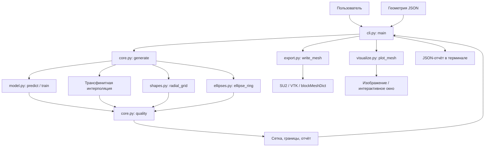
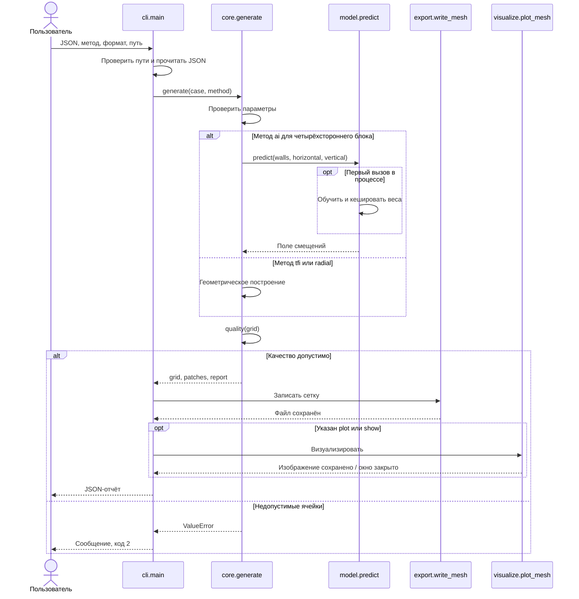

# Диаграммы

Диаграммы Mermaid отображаются при просмотре Markdown на GitHub и описывают текущую реализацию.

## Архитектура

## Последовательность построения

Ошибки параметров могут завершить проверку до построения. Ошибки файловой системы и визуализации обрабатываются отдельно от проверки качества; сетка может быть сохранена до ошибки изображения.

[Описание](overview.md) · [Требования](requirements.md) · [Сценарии](use-cases.md) · [README](../../README.md)
